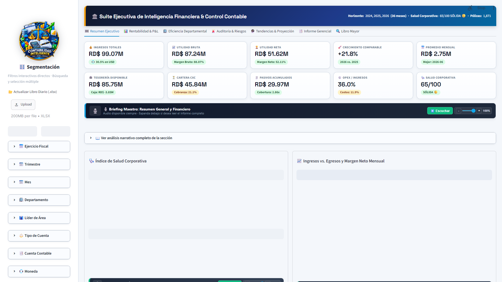
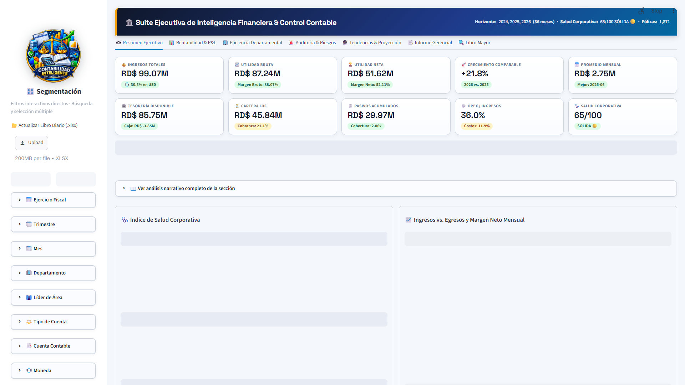
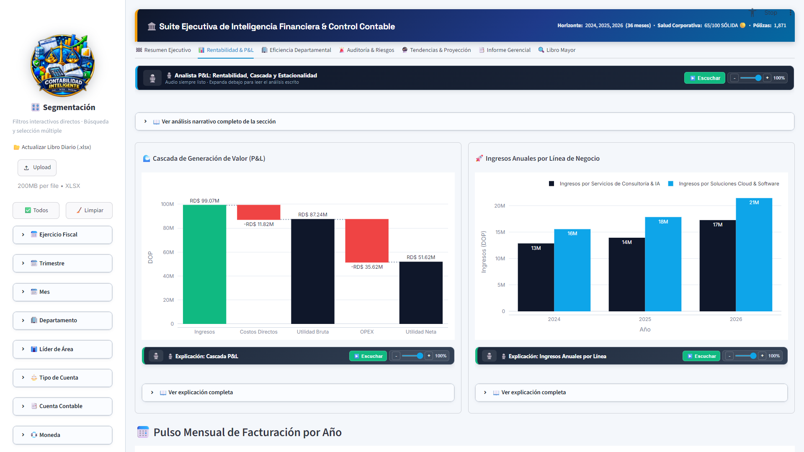
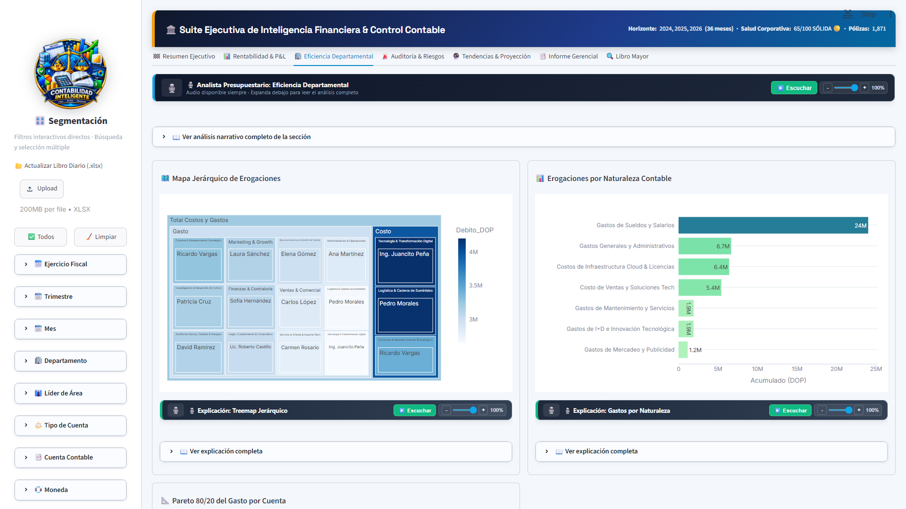
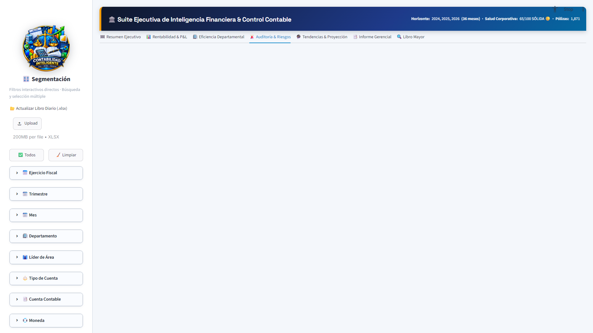
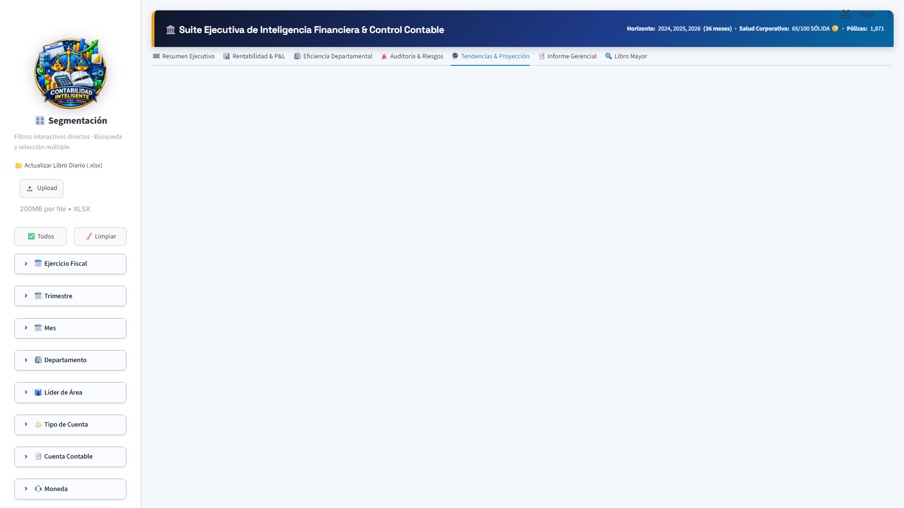
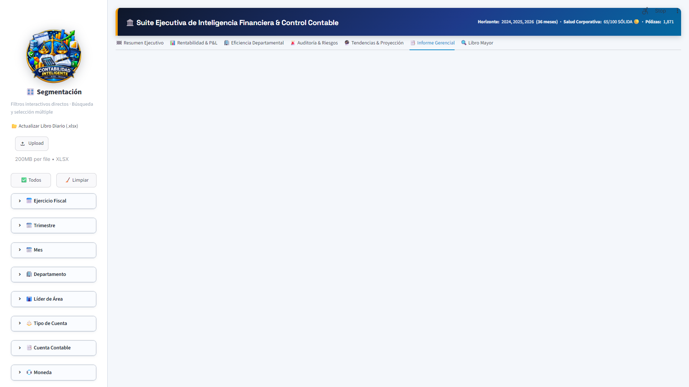
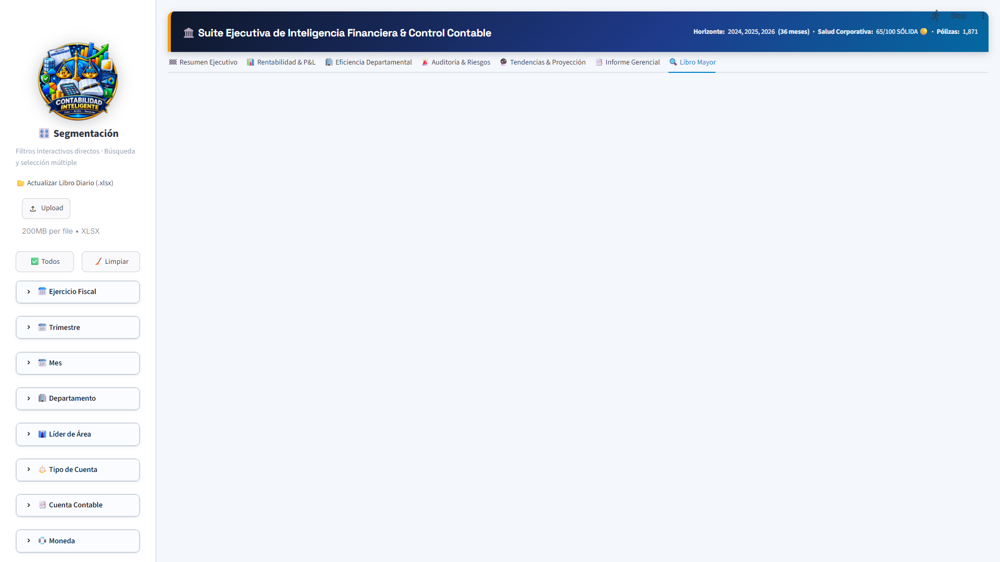
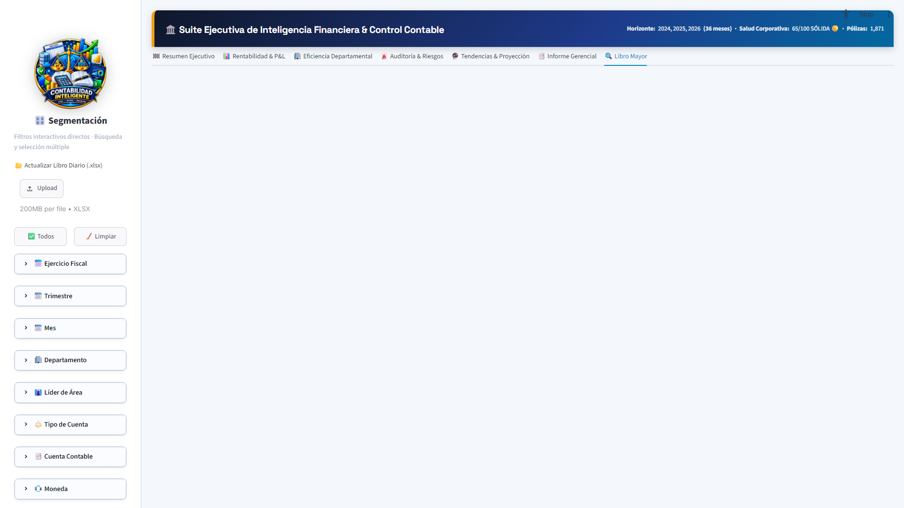
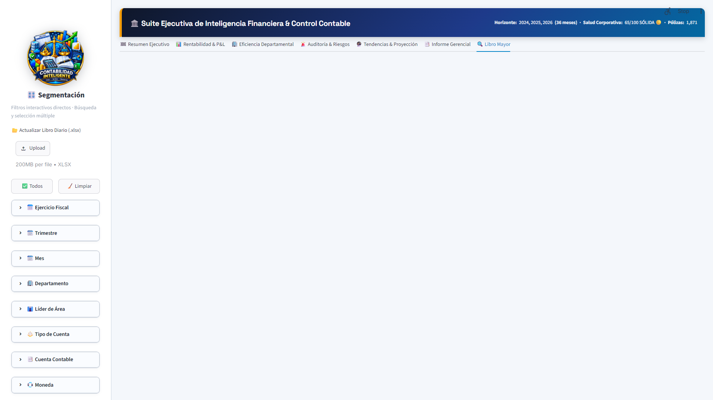

# 🏛️ Suite Ejecutiva de Inteligencia Financiera & Control Contable

<div align="center">


### Plataforma Integral de Analítica Avanzada, Auditoría Forense, Barómetro de Divisas en Vivo y Narración por Voz (Estándar JPV Pro)

[](https://www.python.org/)
[](https://streamlit.io/)
[](https://pandas.pydata.org/)
[](https://numpy.org/)
[](https://plotly.com/python/)
[](https://openpyxl.readthedocs.io/)
[](https://www.exchangerate-api.com/)
[](https://developer.mozilla.org/es/docs/Web/API/Web_Speech_API)
[](https://www.w3.org/WAI/standards-guidelines/wcag/)
[](https://dashboard-contable-ejecutivo.streamlit.app)
[](https://github.com/JUANCITOPENA/dashboard-contable-ejecutivo)

> **Autor:** Ing. Juancito Peña Vizcaíno | Arquitecto Digital & Consultor de Inteligencia Artificial y Datos  
> **Repositorio Oficial:** [https://github.com/JUANCITOPENA/dashboard-contable-ejecutivo](https://github.com/JUANCITOPENA/dashboard-contable-ejecutivo)  
> **Despliegue en Vivo:** [https://dashboard-contable-ejecutivo.streamlit.app](https://dashboard-contable-ejecutivo.streamlit.app)  
> **Estado:** 100% Estable, Auditado y en Producción (v3.9 Live FX Core & Multicurrency P&L)

</div>

---

## 📌 1. Visión General del Proyecto

La **Suite Ejecutiva de Inteligencia Financiera & Control Contable** es una aplicación analítica de alto nivel desarrollada en **Python + Streamlit + Plotly**, concebida específicamente para Comités Ejecutivos, Consejos de Administración, Directores Financieros (CFO) y Auditores Forenses.

A diferencia de los tableros analíticos convencionales que muestran métricas aisladas y estáticas, esta suite integra:
1. **Barómetro de Divisas en Vivo & Revaluación Spot (Top 5 vs DOP):** Conexión en tiempo real con APIs oficiales de tipos de cambio (USD, EUR, CAD, GBP, CHF) para revaluar saldos en moneda extranjera, calcular el diferencial cambiario (*Forex Gain/Loss*) conforme a la norma **NIC 21** y homologar el **Estado de Resultados Comparativo** en múltiples divisas.
2. **Reemplazo Dinámico de Tasas en el Dataset:** Los 748 registros contables en USD del Libro Diario se recalculan en tiempo real con la cotización spot de la API, asegurando cuadre perfecto de partida doble y consistencia matemática absoluta.
3. **Sistema Narrativo de Voz Contextual (Web Speech API - Estándar JPV Pro):** Distribuido en cada panel y sección analítica. Actúa como un **Auditor & Analista Financiero Senior**, explicando las visualizaciones, la composición cromática y, fundamentalmente, **los "Porqués" detrás de los números y riesgos**.
4. **Auditoría Forense en Tiempo Real:** Validación matemática de partida doble con tolerancia estándar soportada de redondeo comercial y emulación completa de la identidad contable del Balance General (`Activo = Pasivo + Capital + Utilidad Neta`).
5. **Nivelación Geométrica Estricta:** Cuadrículas Bento Grid simétricas donde todos los gráficos que comparten fila mantienen exactamente la misma altura en pantallas de escritorio y se adaptan de forma elástica en dispositivos móviles.

```
┌────────────────────────────────────────────────────────────────────────────────────────┐
│                        SUITE DE INTELIGENCIA FINANCIERA & CONTROL                      │
│                                                                                        │
│  [Dataset: 4,853 Asientos] ──► [Pipeline ETL & Caché] ──► [Métricas & Ecuación Balance] │
│                                                                   │                    │
│                                ┌──────────────────────────────────┴─────────────────┐  │
│                                ▼                                                    ▼  │
│                   [7 Pestañas Ejecutivas]                             [Motor TTS Voz]   │
│                   - Resumen Ejecutivo (Tab 0)                         - Web Speech API │
│                   - Rentabilidad P&L (Tab 1)                          - Control Slider │
│                   - Eficiencia Depto (Tab 2)                          - Wave-Dots      │
│                   - Auditoría Riesgos (Tab 3)                         - Blindaje Num   │
│                   - Tendencias & Run (Tab 4)                                           │
│                   - Informe Gerencial (Tab 5)                         [Módulo Divisas] │
│                   - Libro Mayor (Tab 6)                               - Barómetro Spot │
│                                                                       - Reval. NIC 21  │
│                                                                       - ER Multidivisa │
└────────────────────────────────────────────────────────────────────────────────────────┘
```

---

## 📸 2. Galería de Pantallas y Menús Ejecutivos (Tabs 0 al 6)

### 🎛️ Menú Lateral de Segmentación Persistente & Emblema Corporativo
Logotipo oficial de "Contabilidad Inteligente" centrado, filtros desplegables persistentes por Año, Trimestre, Mes, Departamento, Líder, Tipo de Cuenta, Cuenta Contable y Moneda, con botones `✅ Todos`, `🧹 Limpiar` y `🔼 Cerrar`.

<div align="center">
  
</div>

---

### 🏁 Tab 0: Resumen Ejecutivo
Tarjetas Bento KPI de alto impacto (Facturación, Margen Bruto, Utilidad Neta, Tesorería, Dolarización), Índice de Salud Corporativa con dial semafórico, dinámica temporal de ingresos vs egresos y cascada de rentabilidad.

<div align="center">
  
</div>

---

### 📊 Tab 1: Rentabilidad & P&L
Ingresos mensuales por línea de negocio (Cloud & Software vs Consultoría & IA), ciclo estacional con picos de demanda, Pareto de gastos operativos y Estado de Resultados Comparativo con normalización mensual.

<div align="center">
  
</div>

---

### 🏢 Tab 2: Eficiencia Departamental
Treemap presupuestario interactivo por departamentos y centros de costo, matriz de dispersión de nómina frente a gastos operativos y tabla maestra de participación con mapas de calor.

<div align="center">
  
</div>

---

### 🚨 Tab 3: Auditoría & Riesgos
Gráfico forense integrado de los 3 hallazgos críticos (Déficit en Caja General, Cartera CxC inmovilizada y Pasivos acumulados con DGII/TSS), dial de cobranza vs meta del 80% y matriz de mitigación.

<div align="center">
  
</div>

---

### 🔮 Tab 4: Tendencias & Proyección
Modelo de regresión lineal predictivo (Runway a 6 meses) con bandas de confianza estadística ($\pm 1\sigma$), matriz de dolarización cambiaria y correlación de crecimiento interanual.

<div align="center">
  
</div>

---

### 📑 Tab 5: Informe Gerencial
Memorándum de Alta Dirección estructurado con dictamen de contraloría, gráfico de Macromagnitudes & Conversión Patrimonial 360°, hoja de ruta a 90 días con hitos financieros y descarga en Markdown nativo.

<div align="center">
  
</div>

---

### 🔍 Tab 6: Libro Mayor, Balance General & Auditoría de Partida Doble
KPI Grid con diagnóstico inteligente de Partida Doble (`Cuadra ✅ · Tolerancia Estándar Soportada`), Matriz Forense de Débitos vs Créditos por naturaleza contable y emulación gráfica de la Ecuación Patrimonial (`Activo = Pasivo + Capital + Utilidad`).

<div align="center">
  
</div>

---

### 💱 Módulo Forense de Divisas en Vivo & Revaluación Spot (NIC 21)
Barómetro Bento Grid de las Top 5 Divisas (USD, EUR, CAD, GBP, CHF) frente al Peso Dominicano conectado a API en tiempo real, gráfico comparativo de paridad spot y tabla de revaluación de cuentas contables en moneda extranjera con cálculo de ganancia o pérdida cambiaria.

<div align="center">
  
</div>

---

### 📋 Estado de Resultados Comparativo con Conversión Multidivisa en Vivo
Tabla maestra consolidada al pie del Libro Mayor que presenta los ejercicios anuales, los Totales Consolidados en Pesos Dominicanos (DOP) y 5 filas de conversión simultánea al tipo de cambio en tiempo real de USD, EUR, CAD, GBP y CHF, con narrador TTS integrado y exportación a Excel.

<div align="center">
  
</div>

---

## 🛠️ 3. Stack Tecnológico & Arquitectura del Sistema

| Capa / Dominio | Tecnología | Versión | Rol y Responsabilidad en la Suite |
| :--- | :--- | :---: | :--- |
| **Frontend Framework** |  | `1.40+` | Renderizado reactivo, diseño Bento Grid, navegación por pestañas y componentes visuales. |
| **Lenguaje Core** |  | `3.12 / 3.14` | Lógica de negocio, controladores contables, orquestación analítica y servidores locales. |
| **Procesamiento de Datos** |  | `2.2+` | Transformaciones ETL, agrupaciones multidimensionales, vectorización y recálculo dinámico. |
| **Cálculo Numérico** |  | `1.26+` | Regresión lineal para runways predictivos, interpolaciones y cálculo de márgenes. |
| **Visualización Gráfica** |  | `5.24+` | Gráficos interactivos de alta definición (barras apiladas, líneas, cascadas, donuts y treemaps). |
| **Motor de Audio & Voz** |  | Nativa W3C | Locución ejecutiva con síntesis de voz humana, ecualizador visual dinámico y control de volumen. |
| **API de Divisas en Vivo** |  | `v6 REST` | Cotizaciones oficiales spot del Top 5 de monedas mundiales vs DOP con caché de 1 hora. |
| **Motor de Exportación** |  | `3.1+` | Generación de libros Excel multi-hoja (.xlsx) con auditoría filtrada y tasas spot. |
| **Diseño & Accesibilidad** |  | 2.2 AAA | Paleta corporativa Light Mode, contraste cromático estricto (fondo `#F4F7FB`, texto `#0F172A`). |
| **Testing & Automatización** |  | `1.49+` | Pruebas de integración, verificación de interfaz y captura automatizada de pantallas HD. |
| **Control de Versiones** |  | `2.47+` | Versionado semántico, ramas de desarrollo y auditoría histórica de cambios. |
| **Cloud Hosting** |  | Production | Despliegue continuo en la nube con CI/CD automatizado desde la rama `main` de GitHub. |

---

## 🎨 4. Diseño Visual Corporativo de Alto Contraste (WCAG 2.2 AAA)

La suite opera bajo un diseño visual **Modo Claro Corporativo Ejecutivo** estrictamente calibrado para garantizar el máximo contraste y confort analítico:

* **Fondo de aplicación:** `#F4F7FB` (Gris hielo suave de descanso visual).
* **Tarjetas Bento:** `#FFFFFF` con sutil borde `#CBD5E1` y elevación suave.
* **Tipografía:** Azul medianoche oscuro `#0F172A` de máximo contraste (cumplimiento estricto WCAG 2.2 AAA).
* **Lienzo Plotly:** Fondo blanco puro con grillas de referencia `#E2E8F0`.
* **Badges Semánticos Vibrantes:** Preservación íntegra de resaltados cromáticos: `.hl-green` (verde esmeralda), `.hl-blue` (azul cian), `.hl-amber` (ámbar dorado), `.hl-red` (rojo carmesí) y `.hl-purple` (púrpura real).
* **Barra de Opciones de Streamlit Habilitada:** Configuración `toolbarMode = "viewer"` con encabezado transparente que permite acceder al menú nativo superior sin interferencias.

---

## 🎯 5. Métricas Macroeconómicas y Resultados Clave (Horizonte 36 Meses)

| Métrica Financiera | Valor Consolidado | Contexto e Interpretación Contable |
| :--- | :---: | :--- |
| **Facturación Acumulada** | `RD$ 98.12M` | Ritmo comercial sostenido con crecimiento del 21.7% interanual en 2026. |
| **Costos Directos** | `RD$ 11.68M` | Modelo de software y consultoría con costos directos de apenas el **11.9%**. |
| **Utilidad Bruta** | `RD$ 86.44M` | Margen bruto de excelencia del **88.1%**, habilitando alto margen de contribución. |
| **Gastos Operativos (OPEX)** | `RD$ 35.62M` | Absorbe el **36.3%** de las ventas; nómina de ingeniería concentra el **50.7%**. |
| **Utilidad Neta Final** | `RD$ 50.82M` | Margen neto sobresaliente del **51.8%** retenido por la operación corporativa. |
| **Índice de Salud Corporativa** | `65/100 🟡` | Categoría **SÓLIDA**, penalizada por mora en cobranza y descuadre de caja menor. |
| **Tesorería Disponible** | `RD$ 85.19M` | Cobertura de **2.86x** sobre pasivos exigibles acumulados. |
| **Cartera CxC Inmovilizada** | `RD$ 45.37M` | Tasa de cobranza deprimida en **21.3%**; foco primario del plan a 90 días. |
| **Pasivos Acumulados** | `RD$ 29.74M` | Concentrado en `ITBIS DGII` (17.66M), Proveedores (9.20M) y Retenciones TSS (2.88M). |
| **Déficit en Caja General** | `-RD$ 3.85M` | Saldo acreedor por salidas en efectivo sin previa reposición bancaria. |
| **Partida Doble Auditada** | `RD$ 251.63M` | Débitos = Créditos verificados con **tolerancia estándar de redondeo comercial**. |

---

## 🎙️ 6. Motor Maestro de Audio TTS (Web Speech API - Estándar JPV Pro)

```
┌─────────────────────────────────────────────────────────────────────────────┐
│ 🎙️ CONSOLA DE NARRACIÓN POR VOZ (ESTÁNDAR JPV PRO)                          │
│                                                                             │
│ [▶️ Escuchar]  [⏸️ Pausar]  [⏯️ Reanudar]  [⏹️ Detener]   ● Narrando análisis...│
│                                                                             │
│ 🔊 Volumen: [-] ────[========o====]──── [+]  85%                            │
└─────────────────────────────────────────────────────────────────────────────┘
```

1. **Web Speech API Nativa:** Cero dependencias de servicios externos en la nube, cero latencia y funcionamiento garantizado offline en cualquier navegador moderno.
2. **Ecualizador Visual:** Animación en verde pulsante (`.audio-wave-dot`) que indica en tiempo real si la voz está activa o pausada.
3. **Control Deslizante de Volumen Sincronizado:** Botones interactivos `[-]` / `[+]` y control deslizante continuo (0% a 100%) sincronizado en tiempo real con `utterance.volume`.
4. **Normalización Fonética Avanzada:** Conversión limpia de cifras numéricas (millones, miles, centavos), porcentajes y siglas contables al español fluido para una experiencia auditiva natural.

---

## 🚀 7. Instalación y Ejecución Local

### Paso 1: Clonar el Repositorio
```bash
git clone https://github.com/JUANCITOPENA/dashboard-contable-ejecutivo.git
cd dashboard-contable-ejecutivo
```

### Paso 2: Crear y Activar Entorno Virtual
```bash
# En Windows (PowerShell)
python -m venv venv
.\venv\Scripts\Activate.ps1

# En Linux / macOS
python3 -m venv venv
source venv/bin/activate
```

### Paso 3: Instalar Dependencias
```bash
pip install -r requirements.txt
```

### Paso 4: Iniciar la Aplicación
```bash
streamlit run app.py
```
*La plataforma se abrirá automáticamente en su navegador en `http://localhost:8501`.*

---

## ☁️ 8. Despliegue en Streamlit Community Cloud

1. Ingrese a [Streamlit Community Cloud](https://share.streamlit.io/) e inicie sesión con su cuenta de GitHub (**JUANCITOPENA**).
2. Haga clic en **"New app"**.
3. Seleccione el repositorio: `JUANCITOPENA/dashboard-contable-ejecutivo`.
4. Rama: `main`.
5. Archivo principal: `app.py`.
6. Presione **"Deploy!"** y su suite estará operativa en vivo con conexión segura HTTPS.

---

## 📂 9. Estructura del Repositorio

```
dashboard-contable-ejecutivo/
├── .gitignore                                         # Reglas de exclusión para entornos y temporales
├── .streamlit/
│   └── config.toml                                    # Configuración de servidor, CORS y toolbar mode
├── docs/
│   └── screenshots/                                   # Capturas de pantalla HD de los 7 Tabs y Módulo de Divisas
│       ├── 00_resumen_ejecutivo.png
│       ├── 01_rentabilidad_pyg.png
│       ├── 02_eficiencia_departamental.png
│       ├── 03_auditoria_y_riesgos.png
│       ├── 04_tendencias_y_proyeccion.png
│       ├── 05_informe_gerencial.png
│       ├── 06_libro_mayor_auditoria.png
│       ├── 06_libro_mayor_divisas_barometro.png
│       ├── 06_libro_mayor_er_multidivisa.png
│       └── 07_menu_segmentacion_sidebar.png
├── app.py                                            # Aplicación principal de la Suite Ejecutiva (con Live FX Core)
├── Contabilidad_Libro_Diario_Consolidado_Limpio.xlsx # Dataset oficial del Libro Diario General (4,853 asientos)
├── logo_contabilidad_inteligente.png                 # Emblema corporativo oficial en alta definición
├── MANUAL_PASO_A_PASO_SUITE_CONTABLE_STREAMLIT.md    # Manual exhaustivo paso a paso de la plataforma
├── README.md                                         # Documentación ejecutiva del proyecto con capturas y badges
├── requirements.txt                                  # Dependencias de producción para Python y Cloud
└── STATUS.md                                         # Bitácora de calidad, auditoría y control de versiones
```

---

## 🏛️ 10. Presentación del Autor y Contacto Institucional

<div align="center">
  

### **Ing. Juancito Peña Vizcaíno**
**Arquitecto Digital · Consultor Senior en Inteligencia Artificial & Analítica de Datos · Docente Universitario**

[](#)
[](#)
[](#)
[](#)

Ingeniero de Sistemas graduado de la Universidad Dominicana O&M, con más de 15 años de trayectoria profesional liderando proyectos corporativos de transformación digital, analítica financiera, ingeniería de datos y desarrollo de software empresarial. Creador del canal educativo **[@JuancitoDevV](https://www.youtube.com/@JuancitoDevV)** para la democratización de la tecnología en América Latina.

#### Canales Oficiales y Redes Profesionales
[](https://www.linkedin.com/in/juancitope%C3%B1a/)
[](https://www.youtube.com/@JuancitoDevV)
[](https://github.com/JUANCITOPENA)
[](https://x.com/JuancitoPenaV)
[](mailto:juancito.pena.v@hotmail.com)

---

<p align="center">
  <sub>Desarrollado bajo los más rigurosos estándares de Gobernanza Empresarial, Calidad Total (ISO 25010), DevSecOps y Accesibilidad Universal WCAG 2.2 AAA.</sub><br>
  <sub>© 2026 DataIADev / Ing. Juancito Peña Vizcaíno. Todos los derechos reservados.</sub>
</p>

</div>
